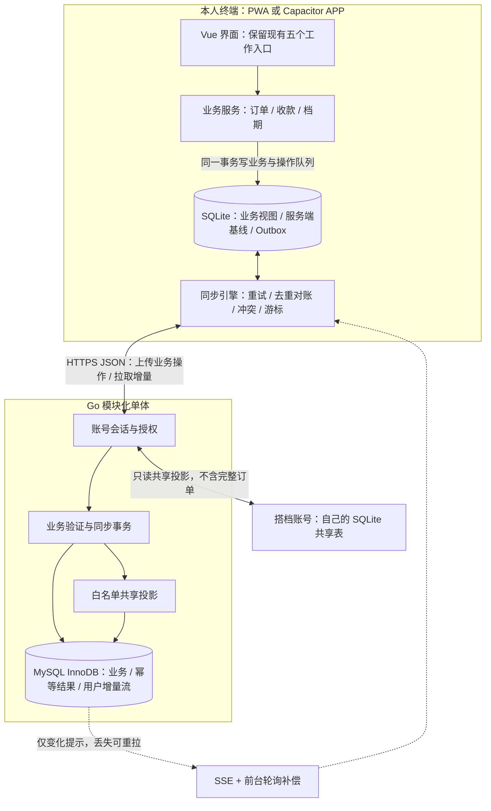

# 探记云端版技术架构与实施计划

- 版本：v0.1，2026-11-21；设计基线，尚未实现。
- 产品约束：[产品需求规格](cloud-prd.md)。
- 基线：`main@aaf57d9`；新分支 `feat/cloud-local-first`，独立 worktree `tanji-cloud`。
- 结论：本地 SQLite 为客户端业务主库，Go 模块化单体服务承担授权与同步，MySQL 保存云端确认状态；使用业务级变更日志，而非数据库物理复制。

## 1. 当前系统与改造边界

| 已核实事实 | 证据 | 架构影响 |
| --- | --- | --- |
| PWA 用内存对象和 JSON 快照读写，localStorage 与 IndexedDB 两副本 | [storage.js:99–179](../storage.js#L99) | 不能在现有 save 后加 HTTP 就获得可靠离线同步 |
| PWA 每次从快照生成内存 SQLite，再导出字节 | [index.html:536–580](../index.html#L536) | SQLite 当前不是 PWA 业务主库，必须换成真正持久事务库 |
| 订单使用递增整数 ID，搭档只是文本 | [index.html:744–763](../index.html#L744) | 迁移到稳定全局 ID，拆分账号关联与外部姓名 |
| 现有金额/收款/催收等规则已有回归基础 | [tests/reliability.test.cjs](../tests/reliability.test.cjs) | 复用规则与测试场景，不沿用快照覆盖协议 |
| 原生分支为 Capacitor 8/iOS，SQLite 保存采用整表替换并读取 settings 内 JSON | 原生分支 `f104941`，[www/storage.js:269–331](../../tanji-native/www/storage.js#L269) | 可复用壳和插件经验，数据适配仍需重做并在真机验证 |
| 原生版本只有 iOS，未发现认证、云同步、地图实现 | 原生 [package.json](../../tanji-native/package.json)、[src/cap-plugins.js](../../tanji-native/src/cap-plugins.js) | Android 和地图不是现成功能，不计入第一期交付 |
| 当前 SW 对同源 GET 广泛缓存且忽略查询串匹配 | [sw.js:9–29](../sw.js#L9) | 云端接入前必须改静态资源白名单，绝不能缓存认证 API 或同步分页 |

以上定位基于列出的提交；未来代码迁移后以对应提交核对，不把行号当成永远不变的接口。

不直接整分支合并 `native-app`，不改其工作区；从云端分支抽出可复用模块后再有选择地接原生入口。当前文档不修改旧业务源码，也不迁移真实数据。

## 2. 总体架构



边界：本人离线提交决定“本机已保存”；MySQL 事务提交决定“云端已确认”；服务端授权决定“谁能看什么”。不是任意多主写库，也不是以云端覆盖本机全部状态。

## 3. 技术选型与取舍

| 层次 | 决定 | 原因与边界 |
| --- | --- | --- |
| 后端 | Go 官方仍受支持的稳定版本，实现启动时锁定补丁版本 | 用户指定 Go；本轮不猜测未来依赖版本 |
| HTTP | 标准库 net/http + chi，OpenAPI 3.1 契约 | 轻量模块化，不引入微服务网关；请求校验和授权由服务端执行 |
| 数据访问 | database/sql + go-sql-driver/mysql + sqlc | 显式 SQL 更便于审查事务、行锁、去重与索引；不用 ORM 隐藏同步边界 |
| 数据库 | MySQL 8.4 LTS，InnoDB、utf8mb4、UTC 连接时区 | 用户指定 MySQL；一个实例起步，正确性不依赖缓存 |
| 迁移 | goose 管 MySQL 迁移；客户端独立 SQLite schema_version | 共享业务模型，不共享方言 DDL；迁移失败不得自动抹库 |
| 前端 | Vue 3 + TypeScript + Vite，保留原 UI 布局和工作流 | 单文件已难承载身份、同步、冲突与共享状态；分阶段迁移，不先做视觉重设计 |
| 前端状态 | 组件/composable 保存界面状态，SQLite repository 保存业务状态 | 第一版不再添加第二个持久化状态仓库，避免 Pinia/JSON 与数据库互为真相 |
| PWA 数据库 | 官方 SQLite WASM，Dedicated Worker，OPFS 的 opfs VFS | 真正事务持久化；按支持的发行版锁版本，强制真实设备能力验证 |
| 原生壳与数据库 | 沿用 Capacitor 8 路线，@capacitor-community/sqlite 原生适配 | 共享 TypeScript 业务/同步模块；SQL 方言与参数接口通过适配器统一 |
| 实时提示 | SSE，仅提示数据变化/会话失效；30 秒前台轮询兜底 | 不把 SSE 当作可靠消息队列，拉取游标才是事实来源 |
| 会话 | 服务端有状态、不透明随机令牌 | 天然可撤销；不采用仅靠长效 JWT 自证身份的单点登录方案 |
| 密码 | Argon2id，每用户随机盐；验证码/会话令牌只存哈希 | 参数经实际服务器性能与安全评估锁定，禁止明文和自制密码算法 |
| 地图 | 原生阶段高德 POI/导航，地图接口薄适配 | 国内使用场景优先；记录来源和 GCJ-02 坐标，商用资格/SDK 隐私另验 |
| 测试 | Go test/race + 真实 MySQL 集成测试；Vitest + Playwright；iOS 真机 | SQLite 不能替代 MySQL 锁与事务测试；桌面模拟不替代原生落盘测试 |
| 初始部署 | Linux Docker Compose：Go、MySQL、Caddy TLS；开发邮件用 Mailpit | 先部署模块化单体，无 Redis、Kafka、Kubernetes；公开生产发布另经授权 |
| 运维 | 结构化 slog、健康检查、同步指标、加密数据库备份/PITR | 日志不记录令牌、完整订单、联系人和地址；运维日志不作为业务同步流 |

版本锁定、SQLite VFS 能力与原生插件升级风险在 M0 形成实测记录，再进入业务实现。采用框架是为了管理新增状态复杂度，不借机重做无关 UI。

## 4. 本地数据库与运行时

### 4.1 持久化边界

- 每个 `environment/account_id` 独立数据库与目录，演示库单独隔离；切换数据库前关闭连接和 Worker。
- 业务写入由 repository 提供统一事务：修改工作视图，同时追加 outbox；两者一起提交或一起回滚。
- UI 在事务成功后更新“已保存”；保存失败保留表单。禁止先修改内存对象，再异步 best-effort 写库。
- 所有写入在单 Worker/单数据库队列执行；长任务分页，网络等待不占用 SQLite 事务。
- SQLite 启用 foreign_keys；Web 首版采用保守回滚日志和 FULL 同步配置，不为了名字像 Binlog 开启 WAL。原生 WAL 是否启用经崩溃恢复测试决定。
- 不同时维护 localStorage/JSON 为另一份业务主库；localStorage 最多存非敏感界面偏好。JSON 只承担明确导入导出。

### 4.2 Web 持久化选择

官方资料：[SQLite WASM Persistent Storage](https://sqlite.org/wasm/doc/trunk/persistence.md)，核对日期 2026-11-21。该页面跟随 trunk，不能据此把未发布接口当成当前可用稳定版本。

- 选择 `opfs` VFS，Worker 运行；部署提供 COOP `same-origin` 和 COEP `require-corp`，WASM/Worker/资源同源托管。
- PWA 验收基线为 Safari/iOS 17+ 与当前受支持 Chrome；不能仅凭浏览器版本或存在 OPFS API 就宣布支持。
- 暂不选择 SAH-pool：官方文档描述其部分版本初始化失败会清理底层存储；还存在连接互斥约束。未确认已发布的保全配置及故障实测前，不承担这个数据安全风险。
- 应用层 Web Locks 保证同源只有一个账本实例；第二页只显示返回原实例的提示，不另开 SQLite 连接。重新接管只能在原持锁页退出后进行。
- IndexedDB/localStorage 不作为“悄悄降级仍显示已保存”的备选。持久化能力不合格则禁止工作账本写入并明确告知；可继续使用旧本机版或原生版。
- `navigator.storage.persist()` 和配额检查只是降低清理风险，不能承诺永不丢失；保留待同步数据导出。
- 首次安装必须联网加载应用资源并初始化身份；已安装、已验证的工作区才支持离线启动。

### 4.3 本地数据结构

| 表/集合 | 目的 |
| --- | --- |
| orders、payment_entries、active_receipts、partner_links、local_settings | 当前本人工作视图，已确认状态叠加待处理操作 |
| shared_schedules | 接收者最小共享投影，只有分享 ID/代次，不含完整订单 JSON |
| server_base | 各聚合最新已确认版本及规范化内容，作为重放与冲突比较基线 |
| outbox | 本地操作 ID、聚合 ID、操作类型、不可变 payload、版本条件/前序操作、状态、会话来源 |
| sync_meta | account_id、schema/protocol 版本、服务端世代、下行游标、最后成功时间 |
| conflicts | 服务端基线、本地意图、拒绝原因、待用户决定的处理状态 |
| migration_map | 旧数据集及旧记录到新 ID 的稳定映射、迁移摘要与检查结果 |

`server_base` 是同步基线，不是另一个任意可写账本；工作视图仅由基线与未确认操作生成。下行更新不能直接覆盖仍有 outbox 的工作行。

## 5. 云端领域模型

### 5.1 类型约定

- 实体和操作 ID：客户端生成 UUIDv4，不依赖时间排序；MySQL 可存 BINARY(16)，SQLite 存规范文本；接口统一字符串。
- 金额：非负整数分，MySQL BIGINT、SQLite INTEGER；JSON 数字必须在 JavaScript 安全整数范围内，服务端同样校验。不要使用 REAL/DOUBLE 记钱。
- 时间：API RFC3339 UTC；MySQL DATETIME(3)、SQLite UTC 毫秒，预约另存 IANA 时区，默认 Asia/Shanghai。
- 旧版本无时区时间在迁移预览中明确解释为所选时区，不能直接当 UTC；按业务时区计算“明天”“本月”。
- 版本号与增量序号用服务端整型递增值，在线路上传十进制字符串；客户端更新时间仅作说明，不作冲突胜负依据。
- 第一版订单为并发聚合：档期、金额、里程碑、收款和撤销改变同一 order_version；共享投影有独立 revision，不暴露 order_version。

### 5.2 主要 MySQL 表

| 表 | 关键字段/约束 |
| --- | --- |
| users | id、标准化邮箱唯一、password_hash、状态、active_session_id |
| sessions | id、user_id、device_id、auth_epoch、token_hash 唯一、到期时间、撤销时间；users 指针决定唯一有效会话 |
| verification_challenges | 用途、接收地址哈希/必要地址、验证码哈希、到期/已使用/失败次数 |
| contact_links、contact_invites | 账号双方、关系状态与代次、邀请哈希/到期；只返回最少账号资料 |
| orders | id、owner_user_id、version、订单字段、档期状态、归档/删除标记 |
| order_places | order_id、地址快照、坐标、坐标系、provider、POI ID；与订单同事务 |
| order_partner | order_id、type(account/external)、partner_user_id 或 external_name，二选一约束 |
| payment_entries | id、owner_user_id、order_id、receipt/reversal、kind、amount_cents、reverses_id；同收款最多一次撤销 |
| active_receipts | owner/order/kind 唯一，指向未撤销的定金或尾款；重复收款还有业务级约束 |
| schedule_grants | owner/order/recipient 唯一 grant_set；share_id、grant_revision、授权来源集合、generation、状态、关联关系代次 |
| schedule_projections | share_id/generation、独立 revision、白名单档期内容；不存完整订单 JSON |
| mutation_receipts | (actor_user_id,op_id) 唯一、payload_hash、处理结果、聚合版本、必要回执 |
| account_domain_guards | 每账本一行，串行化跨订单/关系授权变更的关键事务 |
| user_stream_heads | 每接收账号的当前 seq 与服务端 stream_epoch |
| user_changes | (recipient_user_id,seq) 唯一、事件类型、实体或 share_id/generation、最小内容 |
| entity_tombstones | owner/entity_id、删除版本，阻止旧设备复活已删除实体 |
| bootstrap_snapshots | owner、session、epoch、high_water、快照页/清单、校验和、短时到期 |
| audit_events | 登录替换、授权、收款撤销等必要安全审计，不存明文凭据 |

外键或事务校验须同时约束 owner，不能只验证记录 ID 存在。所有者由鉴权主体确定，客户端 owner_id 只能作一致性校验，不授予权限。

收款流水不可改写/物理级联删除；归档订单仍计入真实收款统计。没有有效收款的订单可逻辑删除，删除事件不销毁审计。每个阶段都测试账务汇总与原版正常行为一致。

## 6. 变更日志同步协议

### 6.1 为什么采用这个方案

借鉴 Binlog 的“可靠记录变化、按位置继续、重放变化”，但只同步领域操作。SQLite 与 MySQL 使用不同适配器和 DDL，不传原始 SQL、数据库页或整库文件。

第一版不做通用 Event Sourcing：业务表仍是云端查询主模型，变更日志服务于传输、审计和同步恢复；不要求永远从全部历史事件重建业务。

### 6.2 操作信封

示例字段示意，尖括号为占位值而非实际请求：

```json
{
  "protocol_version": 1,
  "account_id": "<current-user-uuid>",
  "device_id": "<installation-uuid>",
  "operations": [{
    "op_id": "<immutable-operation-uuid>",
    "aggregate_type": "order",
    "aggregate_id": "<order-uuid>",
    "type": "order.reschedule",
    "precondition": {"expected_version": "7"},
    "payload": {"starts_at": "2026-11-22T02:00:00Z", "timezone": "Asia/Shanghai"}
  }]
}
```

- 请求以当前有效会话授权；`account_id` 必须等于鉴权用户，阻断共享 Cookie 在异步切号时串账。
- outbox 另记 originating_session_id，作为恢复来源而非永久授权；不能用客户端字段伪造服务器会话。
- 操作创建后 payload 和 op_id 不可变；重试保持同一 ID/内容，改错或解决冲突生成新操作。
- `expected_version` 与 `after_op_id` 二选一；新建订单期望版本为 `0`。
- 同一订单后续离线操作引用前序操作的 committed resulting_version；服务端仍比较当前版本，绝不替换成“最新版本就算通过”。
- 版本链中的前序尚未到达返回 dependency_pending；前序冲突/拒绝则暂停该聚合的后继。`after_op_id` 禁止循环、跨账号、跨聚合引用。
- 另外定义 `requires_success: [op_id]`，只要求同账号的前置操作已成功，允许授权命令等待 order.create/partner.assign；它不继承前置操作的版本。该依赖图同样无环，不能借此获得跨账号权限。
- 授权以 `(owner,order,recipient)` 的 grant_set 为独立聚合，使用自己的 grant_revision/version 条件和 generation，不比较 order_version。关系当前有效性仍在执行时校验。
- partner.assign 更新本人选择并在同一事务撤销旧搭档授权来源；新搭档共享由独立 grant 命令完成，等待 assign 成功。拒绝 grant 只阻塞该授权链，不回滚本人订单，也不阻塞其后续编辑/收款。
- 必测离线 create → edit → assign → grant，期间关系被撤销：订单/编辑仍保存，grant 显示明确拒绝，不能形成隐式共享。
- 首版每次最多 50 个操作/1 MiB，按依赖排序；每个操作单独事务并返回独立结果，不宣称整个批次原子成功。

### 6.3 上传事务与幂等

服务端单操作处理：

1. 验证结构、限额与身份，开始 MySQL 事务，锁定当前用户会话行并重新验证 active_session_id。
2. 获取领域保护锁，按既定顺序锁所需订单/授权记录。
3. 查 `(user_id,op_id)`：已处理且 payload_hash 一致则返回已存结果；同 ID 内容不同拒绝。已知会话失效仍先拒绝，不能借幂等接口绕过登录。
4. 验证版本条件、业务规则与当前授权；收款同时验证 active_receipts，不能只依赖 op_id 去重。
5. 在同一事务更新业务、变更授权/白名单投影、写幂等回执、分配各接收者序号并写 user_changes。
6. 提交后再返回结果及发出 SSE 提示。事务死锁/超时整体回滚后按相同 op_id 重试，不能只补其中一张表。

结果分为 applied、already_applied、conflict、rejected、dependency_pending；401/会话失效停止整轮上传，429 尊重 Retry-After，网络/5xx 退避重试。业务冲突不无限自动重试。

已提交结果不随传输日志的过期清理而删除；第一版幂等关键摘要保留到账号数据删除生命周期结束，避免半年后重试旧收款变成新收款。

### 6.4 序号与锁顺序

不能直接以全局 AUTO_INCREMENT 作为“已完整提交的下行游标”：事务先获得小编号但后提交时，读者可能越过它而漏消息。

- 每个接收者有一行 user_stream_heads；锁行、增加 seq、写变化和业务数据必须在同一事务提交。
- 涉及多个接收者时，按接收账号 ID 排序锁所有 head，持有至提交，确保每个账号流的已提交前缀完整。
- 全局锁层级：当前鉴权用户行 → 涉及账本的 account_domain_guards（排序）→ 订单聚合（排序）→ 关系/授权记录（排序）→ stream heads（排序）。任何路径不得逆序持锁。
- 关系撤销可能影响双方账本，必须先锁双方 domain guard；处理订单或授权时复核关系代次，不能使用未加保护的收件人缓存。
- 若预读后发现参与集合已变化，回滚并重新获取完整锁集合，不临时逆序追加锁；死锁仍须检测并重试。
- 单体起步不追求高并发写同一账本，选择清晰事务边界；压力指标证明瓶颈后再细化锁粒度。

### 6.5 下行与本机应用

- `/sync/pull` 使用绑定 account/protocol/epoch 的不透明游标，按 seq 拉取。游标只表示该用户流的位置，不是全局数据库 offset。
- 一页事务包含新基线、共享投影/清除事件、可识别的操作确认和新游标；本机崩溃时一起回滚或一起提交。
- 回执携带规范化聚合和版本；更新 server_base 与将 outbox 标记已确认必须原子完成，避免先移除覆盖层导致界面闪回旧值。
- 收到较旧事件不得降低已确认版本；同版本确认事件仍可用于对账操作，但不回退内容。
- 本人事件可包含 origin_op_id 以恢复“已提交但响应丢失”的状态；共享投影不包含所有者操作 ID、内部 order_version 或财务变化次数。
- 有未确认操作时，在新 server_base 上重放本地意图形成工作视图；版本不兼容则保留冲突，不直接覆盖。
- 应用下行是 replication apply 模式，不再次生成上传 outbox，避免循环同步。
- 上传成功回执不能替代下行游标：即使回执含某个服务器 seq，也不能跳过其他共享变化。

### 6.6 同步调度

- 本地事务成功立即唤醒单实例同步引擎；短批处理合并网络请求，不丢掉独立操作边界。
- 重连：验证会话 → 查询 uncertain 操作回执 → 拉取至本轮 high_water → 对账/重放 → 上传可处理操作 → 再拉取。
- 前台本地新改动尽快上传；SSE 仅唤醒 pull，断线不丢业务；前台 30 秒轮询补偿，后台暂停高频轮询。
- 传输失败指数退避加抖动，上限 60 秒；恢复前台/网络可触发一次提前探测，禁止失败时忙循环。
- 同一聚合出现冲突只暂停相关链；其他订单可继续同步。
- 前台与后台不同时操作同一库；原生后台能力仅作增强，不能把系统必然执行当作正确性条件。

### 6.7 冲突处理

第一版采取保守的聚合版本冲突，不做跨设备自动最后写入覆盖，也不做复杂 CRDT。

- 展示“我的待同步修改”和“云端当前内容”；用户可放弃本地意图，或以当前基线创建新的更正操作。
- 原冲突操作保留结果并标记被取代；不得复用它的 op_id 改 payload。
- 后继操作需重新验证并生成正确的新依赖链，尤其是改价后的收款；不能将旧金额自动套到新订单。
- 收款成功事实以有效 receipt 与撤销关系为准；冲突不能通过“强制本机覆盖”解决。
- 服务端已删除的记录不自动复活；如确需重建，必须用户明确新建，使用新 ID，不悄悄撤销删除。

### 6.8 日志保留、全量重建与服务恢复

- 第一版增量 payload 保留 90 天。过期游标返回 cursor_expired，触发 bootstrap；长期离线不等于禁止恢复。
- 幂等摘要、必要删除墓碑保留更久（第一版到账号删除生命周期结束），防止清理传输日志后重记账或复活 ID。
- Bootstrap 在单个 MySQL REPEATABLE READ 一致性快照中读取账号私有数据、当前授权投影和同一视图的 stream head；完整物化为短期快照后关闭事务，再分页下载。不能只暂停本人上传而忽略其他人发来的共享变化。
- Bootstrap 开始时暂停本机上传，冻结一份待核对 op_id 清单（过大时先分批登记），新本地编辑仍可进入后续队列。服务端在创建快照的同一个一致性视图中返回这份清单的幂等回执，不能只使用 bootstrap 之前单独查询的结果。
- 某操作若在预查询后、快照切点前提交，其内容与成功回执同时进入快照；切点后提交的操作通过后续增量及必要回执查询确认。对账不能把快照中已经包含的收款再次重放为本地未确认收款。
- 快照有 snapshot_id、epoch、high_water、页清单、操作回执清单与校验和，绑定账号/当前会话，10 分钟过期；不跨多个无一致性保证的普通查询拼装。
- 下发每页仍复核共享授权及 generation，已撤销内容用移除控制事件代替；被过滤后重新生成该页校验和，不让旧快照泄露已撤销内容。
- 客户端 staging 区完整校验后，再做一次当前权限及 high_water 之后的增量核对；在一个 SQLite 事务中安装基线、快照/后续回执对应的 outbox 状态及新游标，再重放尚未确认的意图。断网/过期时保持旧库和整个队列可用，不半库上线。
- 云端灾备恢复使用新的 stream_epoch；不能沿用已回滚的 seq 向客户端宣称已同步。客户端发现世代变化即暂停普通上传，保留当前库快照及确认/待确认操作，进入恢复对账。
- **恢复后开放服务的前置门槛是授权状态恢复，而不只是换游标。** 在维护模式下生成不会随数据库备份回退的新 auth_epoch，清空 active_session_id，撤销恢复出来的全部会话及验证码；所有认证路径校验 auth_epoch，旧令牌不得因回档复活。
- 恢复出的联系与共享授权全部进入 recovery_pending 并对接收者拒绝访问；所有者重新认证、对账并明确确认，接收者重新接受联系后才以新 generation 授权，禁止自动恢复旧授权。
- 回档也可能恢复旧密码、已停用或已删除账号。重新开放登录前核对独立保留的安全审计与 PITR 结果；不能仅凭备份中的旧密码登录，要求恢复验证/重设密码。无法核实安全状态的账号保持冻结，由人工身份核验处理。
- 客户端保留最近 90 天的已确认操作回执用于灾备核对；服务端备份与 PITR 是主恢复手段。超出恢复点的数据损失不能许诺自动全补，明确提示差异，禁止把旧客户端视图自动当权威整库灌回。

## 7. 共享与隐私投影

### 7.1 共享数据合同

接收端白名单：share_id、generation、projection_revision、发布者显示名、店名、starts_at、可选 ends_at、timezone、地址文字、可选地图坐标/坐标系/provider/POI、档期正常/取消状态、同步时间。另包含不透明 auth_relation_id 与 auth_relation_generation，仅用于定位撤销范围，在本地共享表建立对应索引，不展示为额外业务明细。

禁止包含：内部完整订单、金额、流水、结算方式、客户联系人/电话、备注、业务渠道、里程碑明细、其他接收者、本人总订单量，以及会泄露财务活动的 order_version。

- 使用独立响应 DTO、独立投影表和 SQLite 共享表，禁止直接序列化 Order 后删除几个字段。
- 只有白名单字段发生变化时才更新共享投影并推送 recipient event；单纯收款/改价不能产生接收端事件或版本变化。
- 查询/搜索/导出/推送/快照走相同授权规则，MySQL 本身不替应用自动执行行级权限。

### 7.2 授权生命周期

- 接受联系邀请不等于共享任何订单；由所有者对订单显式添加主要搭档或查看者。
- 新 grant 发出完整最小投影；每次重新授权使用新 generation，旧授权历史不能重新生效。
- 撤销发出 purge_share 控制事件，仅含 share_id/generation。即使 grant 已无效也要允许该移除事件送达，否则客户端无法清缓存。
- 拉历史 user_changes 时再次验证当前授权：失效投影不能原样返回，改为 purge 或过滤；next_cursor 前进到最后扫描的 seq，即使这一页没有可显示记录。
- 同一人兼有搭档与查看者授权时按有效授权并集保留访问；移除最后一项才撤销投影，UI 展示有效原因。
- 删除联系关系使该关系代次的所有订单授权失效，并发送包含 auth_relation_id/auth_relation_generation 的 purge_relation 控制事件；只清除此精确关系代次的缓存。重新接受关系是新代次，不能自动恢复旧共享；迟到的旧 purge 也不能误删重新授权的新代次。
- 删除与授权变化必须进入接收者流。下行应用只可幂等清除指定共享缓存，绝不能删除接收者本人的订单。
- 身份与授权验证的请求已经返回前，无法收回在途或已下载的内容；这里保证的是撤销提交后的新授权判断，不是远程擦除。

## 8. 认证、单会话与账号切换

### 8.1 认证方案

- 注册/验证/找回使用邮箱，生产邮件服务在发布前配置；第一版不引入手机号短信与社交登录。
- 生成高熵随机不透明 session token，服务端只存 SHA-256 等令牌查找哈希；密码使用 Argon2id，不用同一种快哈希存密码。
- Web 同源 HttpOnly、Secure、SameSite Cookie；变更请求增加 CSRF token 和 Origin 校验。原生用 Keychain 安全存储令牌并通过 Authorization 发送，不用 localStorage/Preferences 存令牌。
- Cookie/令牌不得出现在 SSE URL、查询串或日志中；原生用可发送认证头的流客户端。
- 第一版会话有效期 30 天，在线验证可按政策续期，失效会话不能续活；不把本地已过期凭据作为服务器授权。本人离线使用已解锁工作区不等于拥有有效云会话。
- 权限和会话每请求读取 MySQL 验证，不靠 Redis 缓存正确性；扩容时才引入共享缓存/广播。

### 8.2 单会话原子性

新登录和每次业务写入都锁同一 users 会话行：旧事务若已获得锁则先完成，新登录随后替换；新登录提交后旧事务不能再通过核验。仅在 HTTP 中间件开头检查一次不够。

SSE 通知旧设备遮蔽界面，后续任意请求再次验证；连接建立时和存活期间须校验，不能连接一次就永远有权接收。启动/恢复前台先验证，服务器不可达才进入明确离线状态，不能把明确的 401 当断网继续同步。

### 8.3 未同步数据恢复与切号

- 发现撤销：停止上传、关闭提示连接、锁界面，将队列标记 quarantined，但不删除。
- 同一账号重新认证：先按旧 op_id 查询回执，确认哪些已经提交；再 pull/bootstrap 对账，用户确认后继续仍可原样执行的旧操作。原样重试保留 op_id；需要改内容/版本的冲突更正生成新 op_id 并记录替代关系。
- 不同账号登录绝不能取得旧账号队列，也不能改 owner_id 后上传。
- 切号流程必须停止同步、关闭 Worker/库、清空界面和通知、增加本地 runtime_generation，再开新库。每个异步回调同时检查 account_id、session 和 generation；AbortController 不足以挡住已在途结果。
- Web Cookie 跨标签共享，BroadcastChannel 用于通知锁定/切号，不作为授权依据。API 请求中的账号信封不匹配当前 Cookie 用户立即拒绝。
- 本机独立文件仅保证正常应用不串账；Web 不宣称数据库加密或抵御 XSS/同一系统用户。原生采用 OS 文件保护与 Keychain，SQLCipher 支持性在原生阶段独立验证，不在第一版伪称已加密。

## 9. API 草案

下列是契约边界，不是已存在端点。所有对象接口均做所有者/授权校验；账号资料不开放全站模糊搜索。

| 接口 | 目的 |
| --- | --- |
| POST /v1/auth/register、verify-email、login、logout | 注册、验证、创建/撤销单会话 |
| POST /v1/auth/password/forgot、reset；GET /v1/session | 找回密码、验证当前会话，返回 user/device/session 标识 |
| POST /v1/contact-invites、/v1/contact-invites/accept | 发起与接受账号联系邀请 |
| GET /v1/contacts；DELETE /v1/contacts/{id} | 最小联系人列表与撤销联系/关联共享 |
| POST /v1/sync/push | 业务操作批次及逐项结果，唯一业务写入入口 |
| POST /v1/sync/receipts | 查询本账号不确定操作的处理结果 |
| GET /v1/sync/pull?cursor=...&limit=... | 已授权增量，含页 high_water/next_cursor/has_more |
| POST /v1/sync/bootstrap；GET /v1/sync/bootstrap/{id}/pages/{page} | 一致性全量快照启动与分页 |
| GET /v1/events | SSE 仅通知 changes_available/session_revoked，不承载完整业务数据 |
| GET /health/live、/health/ready | 存活/数据库就绪，不泄露配置 |

业务操作白名单包括 order.create/update/reschedule/cancel/archive/delete、payment.record/reverse、partner.assign、schedule.grant/revoke、settings.update。联系安全操作必须在线；离线订单修改与待授权意图分别记录，不能整单因分享失败而消失。

DTO 校验覆盖字段类型/长度、金额范围、时间/坐标有效性、协议版本、依赖链、负载上限。服务器忽略客户端计算的“已结清/逾期”等派生状态，按事实重算。

## 10. 离线缓存、升级与迁移

### 10.1 Service Worker

- 仅预缓存带版本的静态壳、脚本、样式、图标和 WASM；采用路径精确白名单。
- `/v1/*`、会话/验证码、SSE、bootstrap、用户导出绝不走 Cache API；不要继承当前 `ignoreSearch:true` 的同源 GET 缓存逻辑。
- 所有认证响应设 Cache-Control: no-store；这是额外防线，不能替代 SW 的路径排除。
- 网络下行数据只经授权后写账号 SQLite，不从静态缓存还原另一个账号的数据。
- 升级通知用户安全重启，不能无条件 skipWaiting 并在未提交表单时抢占；数据库迁移前关闭旧 Worker、保留恢复备份、验证 outbox。
- 升级时只清应用自身旧缓存；新旧协议兼容策略明确，不支持的客户端暂停网络写入并提示升级，仍保留可导出的本地修改。

### 10.2 从旧版迁移

1. 用户选择工作数据来源，导出旧 JSON/.db 并验证；新建目标库，不原地覆盖旧库。
2. 预览账号、时区、订单/流水数量、金额汇总及异常；验证原有已收标记和流水一致，不静默补账。
3. 一次性生成 source_dataset_id、规范化内容摘要、旧 ID→UUID 映射，存入 migration_map；流水 ID 也稳定映射，不能每次重试重新生成。
4. 金额按分转换；仅容忍能明确舍入到两位小数的旧浮点误差，其余要求用户核对；旧搭档均为外部搭档。
5. 在 SQLite 事务导入新表及迁移状态，校验统计一致，确认后切换。
6. 登录后明确同意上传，以 migration_batch_id/source_digest 和稳定 op_id 去重；云端已有数据只能预览后增量导入，不能空库误覆盖云端。
7. 旧库只读保留直到新库校验与云端确认完成；删除旧备份需另行明确操作，不自动清理用户数据。

跨域/端口无法直接读取旧站点浏览器数据库时，使用用户导出的备份迁移，不能声称新站点会自动找到旧数据。

## 11. 安全与运维

- 全链路 HTTPS，Web API 与前端同源；原生来源采取明确 CORS 白名单，不使用任意源携带凭据。
- 客户输入始终文本渲染；接入构建后移除内联动态执行，启用 CSP、禁止不可信脚本；依赖锁文件审计。
- 登录/验证码/邀请/批量接口限流；单实例使用进程级限流加持久化挑战次数，重启不能重置验证码尝试上限。
- 数据库仅私网可达，运行账号最小权限，迁移账号与应用账号分离，配置与密钥不进仓库。
- Go/数据库使用 UTC，业务统计按账本时区；客户端时钟漂移不影响去重或版本顺序。
- 监测待同步数量/最长等待、操作失败原因、冲突率、pull 延迟、登录撤销、配额/迁移失败；指标不携带店名、地址、邮箱等高基数字段。
- 第一版生产备份目标：每日完整备份＋持续归档 MySQL Binlog 做灾难恢复，目标 RPO ≤15 分钟、RTO ≤4 小时，必须演练验证。这里的运维 Binlog 与客户端业务同步是两回事。
- 备份加密且与运行实例分离，按保留策略清理；账号删除明确说明备份可能保留到周期结束，不能宣称所有离线副本即时清除。
- 云区域、备案/域名、邮箱服务和地图凭据属于发布前条件，不因本计划自动购买或创建资源。

## 12. 目录规划

以下目录尚未创建，表示实施时的模块边界：

```text
apps/web/                  Vue PWA 入口和界面
apps/native/               Capacitor 入口与平台配置
packages/domain/           金额、状态、时间、业务命令与不变量
packages/local-db/         SQLite repositories、迁移、Web/Native adapters
packages/sync/             Outbox、对账、游标、冲突与运行时身份隔离
packages/api-client/       OpenAPI 生成类型与 HTTP 接口
backend/cmd/server/        Go 服务入口
backend/internal/auth/    账号、会话、验证码
backend/internal/orders/  订单、档期、收款聚合
backend/internal/sharing/ 联系、授权、最小投影
backend/internal/sync/    上传、回执、下行、快照
backend/internal/store/   sqlc 查询与事务协调
backend/migrations/       MySQL migrations
contracts/                OpenAPI 与跨端业务用例
infra/                    本地 Compose、发布模板与备份配置
```

先抽业务与数据接口，再逐页迁移界面；后端仍一个服务。TypeScript 与 Go 不能直接共享可执行业务代码，通过契约及相同测试样例验证一致性。

## 13. 实施阶段与验收门槛

顺序由依赖决定，不在可行性实验前承诺完成日期。下列均为待实施阶段，本轮仅交付两份设计文档。

| 阶段 | 交付 | 通过门槛 | 依赖 |
| --- | --- | --- | --- |
| M0：可行性与契约 | 锁版本；Web SQLite/原生最小事务实验；OpenAPI、领域模型、会话/权限状态机；本地 Go/MySQL 环境 | Safari/PWA 与 iOS 原生新建→事务→杀进程→重开；配额/初始化失败不抹库；原生现有落盘缺陷先核实 | 文档基线 |
| M1：本地数据内核 | 全局 ID、整数金额、repositories、迁移映射、outbox、基线重放；界面逐页接入 | AC01、AC16；用固定基线/事件样例验证 AC03、AC04 的本地部分，不要求尚未实现的服务器；旧账本汇总不变，无半事务 | M0 |
| M2：账号与云端领域 | Go/MySQL 表和迁移、注册/找回、单会话、订单/收款规则、账号运行时隔离 | AC06、AC07 的服务端身份部分；本人数据越权基础、旧会话写入与新登录并发、验证码滥用；搭档权限 AC09 留到 M4 | M0，和 M1 可并行 |
| M3：本人同步闭环 | push/receipts/pull/bootstrap、去重、链式版本、墓碑、冲突页、状态页 | 完整 AC02、AC03、AC04、AC05、AC06、AC07、AC13、AC14、AC15，以及 AC18 的本人数据恢复部分；先不做搭档 | M1、M2 |
| M4：只读搭档协作 | 联系邀请、账号/外部搭档、共享白名单、改期/撤销/SSE 提示 | AC08、AC09、AC10、AC11、AC12 及完整 AC18；历史页/快照越权、回档后授权冻结；仅改价不向搭档发送事件 | M3 |
| M5：原生与地图 | 把同一业务/同步内核接到 Capacitor/iOS，安全凭据、前后台恢复、高德地址选择 | AC17；真机飞行模式、杀进程、切号、导航权限拒绝；不承诺后台实时 | M3/M4；可先发布通过验收的 PWA 内测 |
| M6：发布准备 | 完整回归、性能基准、安全检查、备份恢复演练、灰度迁移和回滚操作 | 产品验收全部通过；明确最低系统；真实账号双设备/双用户验证；发布另获授权 | M4，原生发布还依赖 M5 |

开发优先级不是先堆页面：先证明本地不会丢、同步不会重、权限不会漏，再增加协作和地图。

## 14. 必须覆盖的工程故障矩阵

| 领域 | 注入/测试 | 不变量 |
| --- | --- | --- |
| 本地事务 | 写业务后、写 outbox 前退出；磁盘满；迁移中断；VFS 初始化失败 | 不产生半提交，不自动清库 |
| 上传 | 重复100次、提交后断响应、乱序依赖、不同内容复用 op_id | 恰好一次业务效果，非法重复拒绝 |
| 下行 | 分页中断、空过滤页、旧事件晚到、回执先于事件 | 游标不越过未应用数据，基线不倒退，工作视图不闪回 |
| 并发锁 | 同账本操作并发；小编号晚提交；双方关系撤销/重新授权同时发生 | 没有游标缺口、授权丢失通知或死锁后半提交 |
| 身份 | 登录替换发生在事务核验前后；在途响应返回时切号；共享 Cookie 切号 | 会话边界线性化，回调不能写错账号库 |
| 共享 | grant→revoke→regrant；关系重建后旧 purge 迟到；读撤销前历史页；快照下载中撤销 | 按关系/共享精确代次清除，旧 generation 不复活，新请求不读失效数据 |
| 隐私 | 检查 JSON、SQLite、SSE、搜索、导出、异常日志；仅财务变更 | 禁止字段从未下发，财务变动不侧漏版本/事件 |
| 迁移恢复 | 同来源二次导入、不同设备同备份、超过90天离线；回执预查询后/快照切点前提交；登录替换及撤销共享后的灾备回档 | 快照与回执同一切点；不重复流水、不覆盖待同步意图；epoch 可发现；恢复旧会话/旧权限一律不自动生效 |
| 原生 | 飞行模式、杀进程、系统挂起、Keychain 锁定、拒绝地图权限 | 已提交本地内容可恢复，权限失败不阻断手工记账 |

## 15. 发布前条件与非承诺

设计决策已给出，不需要用户再选择同步算法、ORM 或数据库日志格式。实施前的阻塞项是实际能力验证和外部环境，不是继续讨论抽象架构：

1. M0 证明所选 SQLite WASM/原生插件在目标设备真实持久，支持失败保全；失败时暂停该平台上线，不静默换成易丢的快照。
2. 生产邮件发送、域名/HTTPS、部署区域和数据库备份位置可用；仅经明确授权接入外部服务与真实数据。
3. 高德 SDK 的商用权限、平台 Key、安全与隐私要求完成；未具备前不影响手填地址与核心同步。
4. iOS 构建工具、签名与真机可用；当前浏览器测试不能被报告成原生验收成功。
5. 所有同步性能、备份 RPO/RTO 和权限验收在实现后测量，本文件没有声称它们已达到。
